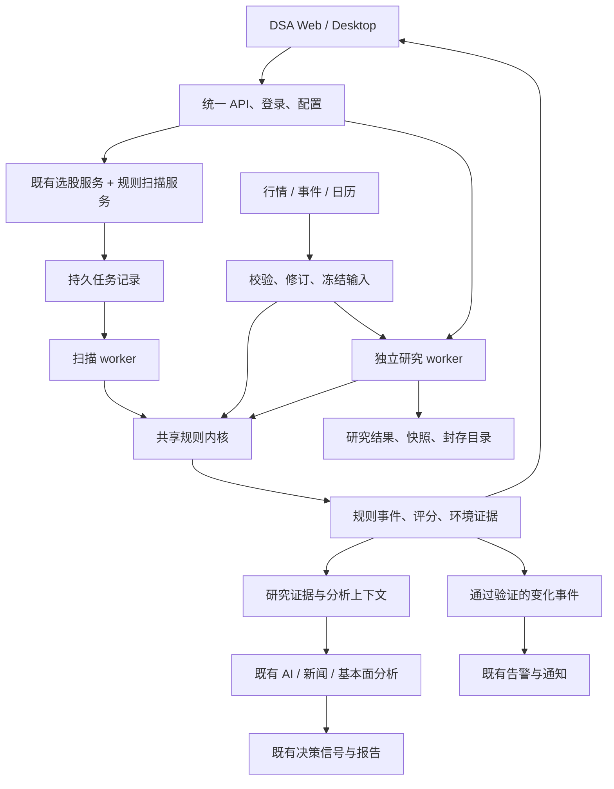

# 交易信号扫描器融合方案

日期：2026-11-08（新加坡时间）  
接收系统：`daily_stock_analysis`，下文简称 DSA  
来源系统：`/Users/mac/Documents/wonmay/交易信号扫描器`  
状态：初始架构提案。用户随后授权完整代码迁移，当前实施范围与操作方式以 [扫描器集成说明](signal-scanner.md) 为准；该授权扩大了本提案的首期范围，但不自动迁移资金、凭据或部署生产服务。

## 1. 推荐决策

**以 DSA 为唯一产品入口，吸收扫描器的规则内核、证据体系和研究验证能力，形成“选股 → 规则扫描 → AI 解读 → 人工判断 → 复盘验证”的闭环。**

目标形态是一个仓库、一套 Web、一套登录和配置入口，后台按任务负载运行不同 worker。扫描器的领域能力成为 DSA 内部模块；扫描和研究数据保留独立存储边界，避免重型回放影响日常分析。

第一期只做美股日线研究：沿用来源系统的研究池与参考资产定义，接入扫描结果、规则证据和 AI 解读。A 股、港股先保留 DSA 原有能力，待独立校准后再推广扫描规则。交易执行、券商同步和资金操作不属于本方案的第一期。

用户最终可以在现有系统完成以下流程：

1. 在“选股”选择美股规则扫描，查看命中标的、没有命中的标的，以及因数据不足无法评估的标的。
2. 在“信号”查看触发条件、待确认/已确认状态、有效期、风险警告和数据时间。
3. 打开单股研究，将确定性证据交给现有 AI 分析、新闻和基本面模块解读。
4. 加入自选股，持续观察状态变化；第二阶段在“回测”内验证规则历史表现。
5. 后续在“持仓”查看持仓关联风险；资金预算与人工计划另行实施。

## 2. 本次核查范围与事实边界

本方案依据两个目录的当前源代码、配置示例、测试文件和说明文件编写。DSA 本地 HEAD 为 `78a9736d2ae98d10aed2cefeae3e7e6e37cc4f4d`，工作区存在较多未提交修改，包括 Web 视觉、配置和文档；这些修改属于当前事实基线。本次没有切分支、拉取、重置或覆盖它们。

来源目录没有在顶层看到 `.git`，因此不能用来源 commit 表示完整基线。迁移来源指纹保存在 [源文件清单](signal-scanner-source-manifest.json)，便于后续判断漂移。

本次未读取密钥、登录凭据或账户账本，未访问正式运行数据库、未调用券商、未运行数据采集或全量回测。源码说明“实现了某能力”，不能据此认定当前生产已启用或数据已更新到最新交易日。

### 2.1 DSA 已有的承载能力

- **选股引擎**：`src/services/screening_service.py` 与 `src/services/screening/` 已有本地选股流水线和历史记录，内含 AlphaSift 派生实现；融合时保留原策略，不再建立第二个全功能选股服务。
- **AI 分析与证据**：`src/core/pipeline.py`、`analysis_context_builder.py`、`research_artifact_service.py` 已提供分析和结构化研究产物。后者支持追加 evidence 与 invalidation 条件，是扫描证据进入报告的自然接点。
- **决策信号**：`decision_signal_service.py`、`DecisionSignalRecord` 已支持持久化、生命周期、数据质量和后续评价。
- **组合与通知**：已有账户、持仓、现金账本、组合风险、告警路由和多渠道通知。
- **回测**：`BacktestService` 主要围绕已生成的分析历史做后验评价，不能直接等同于“从历史输入重新跑规则”的扫描器回放。
- **产品外壳**：React 19 Web、Electron 桌面端、FastAPI、数据中心、设置、任务状态和调度入口均已存在。

### 2.2 扫描器值得吸收的能力

- **12 条规则与共享状态机**：`domain/rules.py` 的 `RuleEngine` 同时服务日常扫描和离线回放，避免两套公式漂移。
- **特征与量价评分**：`features.py`、`rule_parameters.py`、`scoring.py`，包括 ATR、ADX、均线、量价关系、周线、同业/参考资产参与度和评分解释。
- **数据证据**：行情修订、事件可知时间、公司行动、交易日历版本、配置版本、输入快照及内容哈希。
- **信号演化**：触发、确认、过期、失效、撤回，以及父子规则依赖和再次触发条件。
- **规则验证**：`research/` 与 `rule_validation_web/` 提供冻结输入、逐会话回放、结果分布、成本、基准、参数变体、任务取消、封存和复现。
- **后续可选能力**：市场环境、人工 STOP 复核、预算保留、纸面计划、账本和复盘。

源码规则分组如下：TR-01/02/03 为突破、均线交叉与回踩；VP-01 为量价突破，VP-02/03/04/05 为弱突破、供给压力、量价异常和量能衰减警告；MO-01 为区间反弹，MO-02 为 MACD 证据；EV-01 为财报跳空；RK-01 为波动冲击。默认规则阶段均为 `RESEARCH`。

来源 README 的 2026-11-05 更新记载了 100 个扫描标的、13 个参考 ETF、Tiingo 主源及 Alpha Vantage 备用采集。日线仍按 EOD 标记，公司行动未核验时保留限制。这里引用的是文档与代码描述，不是本次对正式库规模、额度或最新行情的验收。

## 3. 架构选择

### 推荐：模块吸收，后台任务隔离

将纯计算内核移入 DSA 的后端目录，将研究模块放在相同仓库中的独立子模块。前端复用现有页面和组件。日常扫描及历史研究使用可恢复的任务记录；研究进程与 Web/AI 线程池隔离。

短期允许旧扫描器继续作为影子对照和回滚入口，DSA 不依赖其在线服务。验证完成后停止旧系统的重复采集、重复调度和重复通知；保留旧研究产物及复现环境。

### 其他路线为何不作为目标

- **只嵌入原页面**：接入快，但两套登录、数据、配置和操作流程仍然存在，只能当临时浏览入口。
- **长期独立服务加 HTTP 转发**：适合独立团队维护或远端部署；当前两个项目技术栈相近，会增加鉴权、版本和故障处理成本。仅当 Python 兼容无法在小范围内解决时，考虑作为计算适配器的过渡方式。
- **一次性复制全部代码与数据库**：会把重复账号、账本、任务系统和不兼容的信号语义一起带入，验收范围过大，不采用。



图中是目标设计，不表示连接已实现。确定性规则负责产出事实与状态，AI 负责解释和综合研判；AI 输出不得修改原始触发条件、规则阶段或数据质量状态。

## 4. 能力如何落到现有入口

### 4.1 选股：复用现有页面，增加扫描模式

在 `StockScreeningPage.tsx` 内增加“策略选股 / 规则扫描”切换，保留既有筛选和历史行为。规则扫描首版仅开放美股，并分别显示方向信号、风险警告和无法评估原因。

扫描任务输出不能直接套用既有候选排名分数。规则筛选按规则、阶段、生命周期、质量等级、数据日期进行；已有 AI 选股策略保持原来的评分定义。

### 4.2 信号：一个入口，两类对象

在 `DecisionSignalsPage.tsx` 内增加“AI 决策 / 规则事件”视图。共享股票身份、时间筛选与详情布局，但分别调用相应数据接口。

规则详情展示触发条件、当前数值、冻结锚点、父事件、状态时间线、质量评分明细和不可用原因。方向信号与风险警告可以同时存在，用户能看见冲突的证据。

### 4.3 单股研究与 AI：将规则结果作为证据

在 `analysis_context_builder.py` 增加可选的规则证据块，经 `research_artifact_service.py` 进入报告。证据必须绑定事件 ID、修订、规则版本、交易日和输入快照。

先提供用户主动触发的“AI 解读”；后续才考虑对新增或变化的重要信号自动解读。缓存键包含证据版本、分析配置和模型配置标识，避免每日对全池无差别调用模型。缺少扫描结果不能阻断原有单股分析。

若 AI 看多但规则提示风险，报告并列解释分歧；不能把警告从证据中删去，也不能将研究级规则升级为已获验证的交易建议。

### 4.4 回测：同一页面，保留三种评估口径

`BacktestPage.tsx` 中区分现有“报告后验评价”、现有“决策信号结果评价”和新增“规则历史回放”。保留各自样本来源、计算版本、期限和分母，不合成一个笼统胜率。

冻结回放、参数变体和封存由扫描器研究模块提供；大行情图、事件细节和下载可作为该页面的子路由。原始统计必须披露未完成、缺数据、不可评估和重复经济事件的处置。

### 4.5 数据中心、持仓和通知

- **数据中心**：扩展 `DataCenterPage.tsx` 和 `data_capability_service.py`，展示 EOD/RTH、PIT 能力、事件覆盖、公司行动、最新交易日、参考资产缺失、配额与失败原因。
- **持仓**：先在 `PortfolioPage.tsx` 将持仓与规则警告关联，复用现有组合风险；不导入第二份资产余额。
- **通知**：通过现有 alert/notification 路由发送规则状态变化。第一期默认不启用新增自动推送，后续按独立配置开放；失败不影响扫描保存。
- **全景大屏**：待数据和状态稳定后按需要吸收为只读视图，不作为首期主入口。

前端沿用 DSA 根目录现有 `DESIGN.md` 的 IBM/Carbon 方向及现有组件。来源扫描器使用 Linear 模板，不整体迁移其 CSS、登录壳和导航。本次是现有项目的架构规划，未创建新应用，也未替换两边的设计文件。

## 5. 必须先统一的业务契约

### 5.1 规则事件与决策建议分开保存

当前 `DecisionSignalService` 会按股票、市场和 decision profile 使较早的相反行动失效。扫描器却需要同时保留看多方向、看空警告及辅助证据。若把所有规则逐条写成 `buy/sell`，就会错误地互相失效。

因此新增规则事件与事件修订存储，**第一期不将原始规则事件写入 `decision_signals`**。规则结果作为研究事实供 AI 或用户消费；生成综合建议时，才走既有决策服务的单一写入路径。

`source_type` 当前只接受 `analysis/agent/alert/market_review/manual`，没有 `scanner`。第一期无需扩枚举：AI 报告仍按已有来源保存，原始规则引用放在证据中。如果以后需要规则直接生成决策，须同时修改 API schema、服务校验、前端类型、结果统计、生命周期和兼容测试，不将其伪装成 `manual` 绕过约束。

### 5.2 四个状态维度独立

- **生命周期**：待确认、已确认、过期、失效、撤回。
- **规则阶段**：研究、停用、批准等来源规则注册状态，保留原始值与生效时间。
- **数据资格**：可计算、过期、缺事件、公司行动未核验、不可评估。
- **业务资格**：仅供观察、可进入人工复核、被门禁阻断。

“已确认”只表示规则确认条件成立，不能等同于规则通过研究验证、账户允许开仓或用户授权交易。界面不得用一个绿色“有效”覆盖这四种含义。

### 5.3 评分不能混用

保留扫描器 `quality_score`、`quality_grade`、`effective_grade` 与评分轨迹；保留 DSA `score`、`confidence` 的原定义。扫描质量分不是获利概率，也不是 AI 置信度。

源码中 WARNING 类规则不打质量分，缺少评分输入时也返回空分值和原因。融合后继续展示“未评分 / 输入不足”，不能补成零分、平均分或高置信度。MO-02 等 EVIDENCE 类规则作为佐证，不能重复当独立选股机会统计。

### 5.4 数据口径与证券身份

DSA `stock_daily` 的唯一键为 `(code, date)`，现有 `canonical_id` 已追加但读取迁移尚未完全切换；该表不足以保存同一天的多个供应商修订和历史可知时间。

扫描输入必须保留稳定证券 ID、显示代码、供应商别名、市场、资产类型、角色、原始价格、复权依据、成交量单位、会话类型、来源、修订、可用时间和采集时间。`BRK.B/BRK-B` 等映射由主数据管理；不能仅做字符串替换。SPY、行业 ETF 等参考资产与交易池分开，避免参考资产制造同业共振。

现有日线缓存可作为“当前已知数据”的辅助来源；若缺少证据，只能标为相应的 EOD/修订历史研究输入，不能凭补字段变成 RTH 或 PIT 数据。

### 5.5 时间与研究资格

分别保存 `market_date`（交易日）、`available_at/known_at`（当时可用时间）、`ingested_at`（进入系统时间）、`evaluated_at`（计算时间）。接口使用带时区时间；旧表使用无时区 UTC 的路径必须经显式转换，不能按机器时区解释。

来源正式研究输入有 RTH 证据检查；另外的 `scripts/replay_local_eod.py` 是明确的 EOD 诊断路径。融合时保留这一区别，不能给正式验证器加一个宽泛 fallback 来容纳缺证据的日线。

日历适配器可复用 DSA 市场身份，但扫描器需要会话开闭、提前收市、周线截断、会话位移和固定版本。DSA 原有交易日过滤在依赖缺失时有 fail-open 行为；扫描/正式回放在日历缺失时必须显式不可评估，不能照搬这一降级。

## 6. 数据、任务与运行方式

### 6.1 存储分工

DSA 主库继续拥有用户配置、分析历史、现有决策、组合、通知及其既有模型。

扫描域保留一个专用 SQLite 存储，通过 `src/repositories/` 的仓储接口访问；拥有证券映射、行情/事件修订、规则与配置版本、扫描运行、规则事件及修订、聚合卡片和审计。优先适配来源 schema 的可复用部分，不为同一事实同时维护新旧两套表。

研究控制库与封存目录保持隔离，拥有实验、输入清单、运行状态、结果索引和只读产物。大体积历史包和冻结行情不塞入 DSA 的报告 JSON，不把整个 `data10/`、`runtime/` 或旧凭据目录复制进仓库。

跨库操作不假设具有原子事务。以稳定事件 ID、修订与内容哈希做幂等投影；记录最后处理位置，重启后重放并校验。读取列表只读，刷新页面不补算、不发送通知。

SQLite WAL 允许读写并行，但同一时刻仍只有一个写入者；多库写入也不能当成一个原子提交。因此建议后台计算完成后短事务写入、研究库独立、失败可重放，而不是让长回测持有业务库事务。依据：[SQLite WAL 文档](https://sqlite.org/wal.html)。

### 6.2 一个采集责任方，一份配额账本

同一供应商、账户与数据集只允许一个明确的采集责任方。首期可先消费核验后的已有导出与快照；接管增量采集时，再把 Tiingo/Alpha Vantage 的适配器、持久额度和断点续跑逻辑接入现有 `data_provider/` 和配置入口。

来源代码中的请求预算是原环境配置和实现，不代表当前供应商官方额度或 DSA 的可用权限。不能把多个 key 数量直接乘成许可吞吐量；先核验实际订阅和出口限制。FRED/VIX 或行业参考缺失时，保留 UNKNOWN 及其原因。

凭据由 DSA 现有配置与保护机制管理，新增项同步 `.env.example`、配置注册和相关文档。迁移包排除 `.env`、`service.env`、`auth.json`、cookie、密码文件和任何 key 文件。

### 6.3 可恢复任务与资源隔离

DSA `AnalysisTaskQueue` 使用进程内字典和线程池，适合现有交互分析，但不能直接承担需重启恢复的长回放。复用其状态展示接口的思路，扫描/研究执行则保留来源持久作业机制，经 DSA 服务层提供统一任务 DTO。

作业逻辑键至少包含类型、市场、交易日、证券池版本、规则配置版本和输入快照。任务领取使用原子状态变化及过期恢复；完成、取消、失败和未知结果有明确区分。人工重试关联旧作业并保留理由。

默认扫描与研究各限制并发，研究启动还要经过磁盘、内存和队列容量检查。先测量目标部署，再决定是否提高并发；不在本轮引入 Redis、Celery、PostgreSQL 等全局迁移。

调度顺序为“采集完成 → 数据门禁 → 冻结输入 → 扫描 → 持久化 → 可选 AI/通知”。美股数据就绪时刻按纽约时区和交易日历计算，不将宿主机的亚洲时区定时任务视为收盘完成证据。

### 6.4 Python、Web 和 Desktop 兼容

来源项目声明 Python `>=3.12,<3.15`；DSA Docker 当前为 Python 3.11，后端 CI 也覆盖 3.11。P0 必须检查拟迁移内核及依赖是否能在现有版本运行，不能因为两边都是 Python 就宣称可直接导入。

优先把可复用内核兼容到 DSA 现有运行环境，并用原测试和双引擎输出验证。若存在无法小范围解决的 3.12 依赖，单独设计扫描 worker 的运行时与打包，或另开基础环境升级；不得随本次功能静默升级整个应用。

两边都是 React 19，但 Vite 等构建版本不同。只迁移组件逻辑与视图需求，依赖以 DSA 锁文件为准，不合并两个 `package.json`。

同一仓库内的 worker 并不意味着桌面端自动支持：Web、CLI、Docker、Electron 的子进程启动、停止、路径、日志和恢复都要分别验收。桌面端支持若延期，应明确显示尚未支持，不能让菜单指向不可运行的任务。

## 7. 建议的代码边界

以下是实施目标，不是当前已经存在的新增文件。

```text
src/core/signal_scanner/                 规则、特征、参数、评分、日历协议、确定性哈希
src/services/signal_scanner_service.py   扫描编排、查询、证据投影
src/repositories/signal_scanner_repo.py  扫描域存储与迁移
src/schemas/signal_scanner.py            输入、事件、质量、任务契约
src/services/rule_validation/            研究编排与隔离执行，复用同一规则内核
data_provider/                          行情/事件适配，保留来源证据
api/v1/endpoints/                       新增扫描、规则验证端点
api/v1/schemas/                         对外请求与响应校验
apps/dsa-web/src/components/            扫描结果、证据详情、验证报告组件
tests/                                 来源黄金样例、适配测试、系统回归
scripts/                               导入核验、对照运行、迁移与恢复工具
```

建议 API 命名空间为 `/api/v1/signal-scanner`、`/api/v1/rule-validation`，具体端点和 DTO 在 P0 固定。查询只读；创建任务返回任务身份；重试与取消有幂等及状态冲突处理。第一期保留原 `/api/v1/screening` 和 `/api/v1/decision-signals` 的已有契约。

鉴权复用 DSA，但新写操作必须保证幂等、版本检查和审计，不能因为不移植来源登录系统就丢失其写入保护。若启用对外可访问的扫描管理功能，必须使用已配置的认证边界；不静默改变 DSA 其他使用方式。

来源 `app.core` 中的序列化、哈希、十进制和时间辅助也是迁移依赖。保持原 event ID、输入哈希和数值语义；确需修改时升级算法版本并保留旧版本复现能力，避免只搬 `rules.py` 导致结果身份变化。

## 8. 分阶段实施与验收

工作量是基于源码检查的初估，以工程人日计，不是交付承诺。P0 后根据依赖兼容、数据质量和现有并行修改修订。首期研究闭环预计 **12–19 人日**；研究验证预计再增加 **6–10 人日**；账户计划另估。

### P0：冻结边界与输入样例，2–3 人日

交付：来源文件/依赖指纹、最小内核依赖图、Python 兼容结果、证券映射、数据合同、状态字典、原输出样例、许可证/数据使用范围核查结果。

验收：使用相同冻结输入能够说明每个输出字段的来源；明确哪些规则可评估、哪些缺事件；不依赖生产密钥；不修改当前工作区已有业务变更。建立独立实施分支或隔离副本时遵守仓库确认要求。

### P1：内核与数据接入，5–8 人日

交付：抽取共享计算内核、扫描域仓储、历史输入导入、持久扫描作业、只读 API。12 条规则的内核可整体迁移；对缺少真实输入的规则返回不可评估，尤其不能给 EV-01 填造财报事件。

验收：新旧引擎在相同样例上的事件身份、触发/确认时间、生命周期和缺失原因完全一致；浮点特征使用预先声明的容差；重跑不重复写事件；半途终止后可恢复；不影响原有分析与数据库。

### P2：现有页面与 AI 闭环，5–8 人日

交付：“选股”的规则扫描视图、“信号”的规则事件视图、单股证据、手动 AI 解读、自选关联、数据中心质量状态、运行诊断。

验收：从扫描到证据到 AI 报告可以完整操作；WARNING 没有伪造评分；未知数据不显示正常；规则冲突可以并存；原来的决策信号和历史记录行为不变。覆盖宽屏和窄屏，并提供页面截图。

**P0–P2 是建议首先实施的范围。** 先用影子模式比较至少 5 个完整交易会话，确认数据与运行稳定；这个观察窗口用于工程验收，不证明策略有效。

### P3：规则验证研究闭环，6–10 人日

交付：研究任务、冻结输入登记、5/10/20 会话评价、成本与基准、参数预登记、逐事件明细、取消、封存、旧版本复现。

验收：修改未来数据不改变过去信号；晚到事件和公司行动不能提前泄漏；EOD 诊断与正式 RTH/PIT 验证可清楚区分；数据哈希不符时拒绝运行；回放失败不拖垮 Web 和日常分析。小样本、幸存者偏差与缺失覆盖在报告中明确披露。

### P4：持仓风险与人工计划，另行确定范围

先做持仓关联警告，再考虑 STOP、风险预算和纸面计划。来源风险引擎围绕股票数量、已结算现金和固定账户假设设计，不能直接替代 DSA 的多账户、多币种组合，也不能套用为期权或组合保证金规则。

若实施预算保留，必须由一个账户事实源计算净值、现金、已占用风险与未完成计划；保留、释放、过期和撤销在同一事务域中完成。纸面、自报实盘和研究影子账户分开，旧账本只能经显式映射和对账导入。

## 9. 数据迁移与切换流程

1. **盘点与冻结**：核对需要迁移的规则版本、证券池、历史输入、产物和许可范围；生成清单及哈希，明确源库路径由配置提供。
2. **一致性备份**：对活动 SQLite 使用备份 API 或经过验证的备份机制，校验关联 artifact 和 manifest；不单独复制正在写入的 `.db` 文件。参考：[SQLite Online Backup API](https://sqlite.org/backup.html)。
3. **导入隔离目标**：先迁移只读输入和研究产物，再导入经验证的事件。保留原 ID、修订、来源日期和旧系统身份，不重新解释为新生成信号。
4. **对照运行**：旧系统继续服务，新模块消费相同冻结输入进行比对；记录所有差异，不能用总条数相等代替逐事件一致。
5. **受控开放**：开放 DSA 查询和主动扫描，再逐步接管采集与定时任务；每种任务明确唯一拥有者，避免两边同时执行。
6. **保留回退窗口**：关闭新扫描任务和证据注入即可恢复原 DSA 路径；确认旧环境数据与配置可恢复后，再考虑旧服务退役。

跨库索引或投影失败允许重建；原始输入、旧规则事件和封存文件不可为迁就新 schema 而覆盖。不要自动导入旧会话、待发通知或预算保留，避免恢复后产生意外副作用。

## 10. 验证矩阵与关键反例

实现阶段需要以下证据，不能只用前端能打开或 CI 绿色作为验收。

- **指标和状态一致**：复用来源 `test_golden.py`、`research/test_rules.py`、`test_score_dependencies.py` 的黄金样例；增加真实适配层测试，覆盖触发、确认、失效优先级、重触发、拆股和参考资产缺失。
- **研究时间正确**：覆盖延迟公布财报、晚到行情修订、夏令时、提前收市、周线未收完、PIT 与修订历史区分；对未来数据的扰动不得改变历史信号。
- **数据降级正确**：不足 260 个会话、停牌/缺交易日、最新修订无效、VIX 过期、公司行动未知、供应商限流和缓存过期，应给出明确不可评估或限制，不能退回旧数据冒充新数据。
- **并发与恢复**：重复提交、相同 key 不同参数、计算后落库前崩溃、投影后确认前崩溃、取消和完成竞态、写锁、磁盘不足、worker 重启、重复调度槽位。
- **既有功能兼容**：原选股策略、AI 分析、决策信号相反行动处理、持仓风险、通知和报告后验评价不变；来源规则警告不误写成 `sell`。
- **API 与客户端**：认证、幂等、分页、旧客户端未知可选字段、错误/过期状态展示；Web 与 Desktop 对新增路径给出一致或明确受限的体验。
- **备份恢复**：在新目录恢复，验证 hashes、撤销/不导入旧会话、抑制历史待发通知，核对新旧系统的调度责任方。

按仓库规则执行后端 `./scripts/ci_gate.sh`、相关新增回归、Web 的 `npm ci` / lint / build；影响 Desktop 时先构建 Web 再验证桌面启动和退出。新增目录不一定被现有语法检查枚举覆盖，要确认实际测试收集结果。Docker、平台特定打包与在线供应商测试若未执行，必须明确记录。

## 11. 风险、暂缓项与回滚

主要风险来自行情与事件证据缺口、信号语义混用、Python 依赖差异、双调度与跨库一致性。首期以可解释的研究功能交付；不会承诺所有 12 条规则在现有真实数据下都能输出，也不会承诺历史数据能证明策略盈利。

暂缓：全市场十年数据整体搬迁、第二套认证/配置中心、第二套组合账本、将规则直接当自动交易指令、A/H 市场无校准复用、美股扫描器向期权/保证金风控泛化、全站依赖升级和全局数据库迁移。

回滚优先关闭扫描入口、调度和证据注入，不删除新域数据，不逆向修改既有分析记录。研究 worker 可独立停止；若新采集责任方已接管，回滚必须先停新作业，再恢复旧作业，避免重复采集。主库尽量只做向后兼容的追加变更；任何资金计划能力上线后，需单独设计对账和回滚，不能沿用只读研究模块的退出方式。

## 12. 初始方案阶段记录（实施前）

初始方案阶段仅新增方案文档和阅读摘要。此后用户已授权完整代码迁入，实际实现、验证及能力边界以 [集成说明](signal-scanner.md) 为准。

原方案阶段为 Docs only, tests not run。当时核对了文中引用的主要源码路径、现有验证入口与版本声明；未执行集成测试、线上验收或策略回测。方案是中文专项设计，没有对应英文文档，现有中英文用户说明未修改；实施用户可见能力时再同步相关说明及 `docs/CHANGELOG.md`。

建议从 **P0 的输入/状态合同与双引擎样例开始**，以“在 DSA 内完成一次美股规则扫描、看见证据、调用 AI 解读”为第一期验收目标。先证明核心流程一致，再扩展研究验证和人工计划。

## 13. 核查依据

接收系统关键源码：

- [选股服务](../src/services/screening_service.py)、[选股流水线](../src/services/screening/pipeline.py)。
- [决策信号服务](../src/services/decision_signal_service.py)、[决策 API schema](../api/v1/schemas/decision_signals.py)、[存储模型](../src/storage.py)。
- [研究产物投影](../src/services/research_artifact_service.py)、[研究产物 schema](../api/v1/schemas/research_artifact.py)、[分析上下文](../src/services/analysis_context_builder.py)。
- [报告后验回测](../src/services/backtest_service.py)、[数据能力](../src/services/data_capability_service.py)、[任务队列](../src/services/task_queue.py)、[运行调度](../src/services/runtime_scheduler.py)、[交易日历](../src/core/trading_calendar.py)。
- [Web 导航](../apps/dsa-web/src/components/layout/SidebarNav.tsx)、[设计规范](../DESIGN.md)、[Docker](../docker/Dockerfile)、[CI](../.github/workflows/ci.yml)、[后端验证入口](../scripts/ci_gate.sh)。

来源系统关键源码（下列均相对来源根目录）：

- `backend/app/domain/{features,rules,rule_parameters,scoring,calendar,risk}.py`。
- `backend/app/worker/pipeline.py`、`backend/app/storage/{db.py,schema.sql}`。
- `backend/app/research/{contracts,inputs,runner}.py`、`backend/app/services/rule_validation_web/`。
- `backend/app/services/{daily_market,plans}.py`、`backend/app/main.py`、`backend/app/core.py`。
- `backend/tests/test_golden.py`、`backend/tests/test_score_dependencies.py`、`backend/tests/research/{test_rules,test_eod_diagnostic}.py`。
- `README.md`、`pyproject.toml`、`frontend/package.json`。

